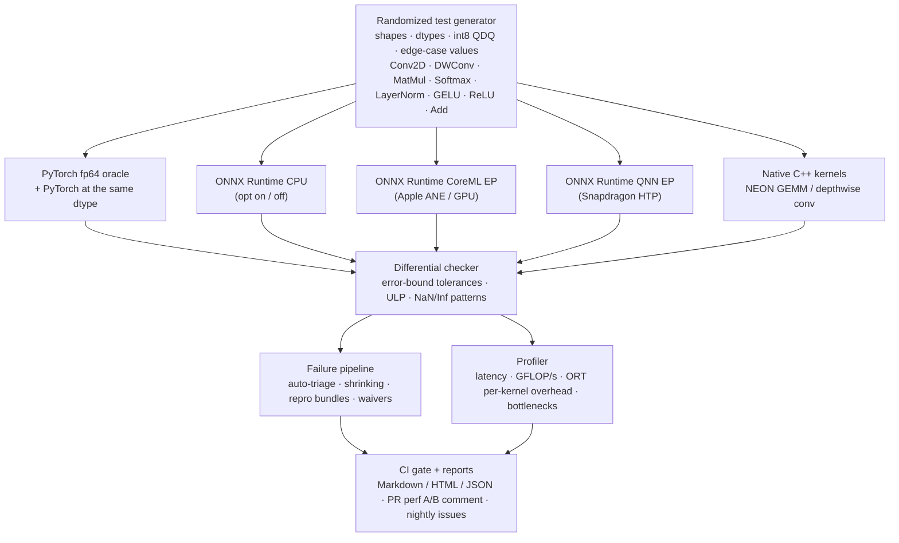

# NeuralProbe: AI Backend Validation, Fuzzing & Operator Optimization

**C++ · Python · PyTorch · ONNX Runtime · QNN · GoogleTest · ARM NEON · Linux · Bash · GitHub Actions**

NeuralProbe is a testing infrastructure for ML inference backends. It generates randomized operator test cases,
runs them on several backends (ONNX Runtime CPU, CoreML, the Qualcomm QNN Execution Provider, and hand-written
C++/NEON kernels), and compares every output against an fp64 PyTorch oracle. Each failure is triaged and
minimized automatically and saved as a standalone reproduction. A CI regression suite blocks merges on new
numerical failures or performance regressions and generates a diagnostic report for each run.



## Bugs and precision issues found

These came out of the first CI-sized campaign (320 generated cases, 982 backend executions, ~12 s on an M-series
Mac with onnxruntime 1.31). Every row is a real upstream behavior, reproduced from an auto-minimized bundle. Each
is tracked as a waiver in [`configs/waivers.yaml`](configs/waivers.yaml), so it stays visible in reports without
failing CI.

| ID | Backend | Finding | Auto-triage result | Minimized repro |
|---|---|---|---|---|
| NP-001 | ORT CPU (arm64) | MatMul with a constant (prepacked) weight **drops NaN**: returns `-FLT_MAX` (fp32) / `-inf` (fp16) | disappears with `mlas.disable_kleidiai=1` → KleidiAI micro-kernel clamp | `1x1 @ 1x1` |
| NP-002 | ORT CPU | QDQ MatMul with per-channel weights + batched B **crashes at runtime** in `QLinearMatMul` | disappears with graph optimizations off → the QDQ fusion emits a node its kernel can't run | `1x1 @ 1x2`, batched B |
| NP-003 | ORT CoreML EP | Softmax on a rank-3 tensor with `axis=-3` returns **wrong values** (equivalent `axis=0` is correct) | passes on the CPU EP → EP bug | shape `[1,1,2]` |
| NP-004 | ORT CoreML EP | fp16 GELU flushes outputs of ~1e-3 to 0 for x < -3 (`1+erf` cancels in fp16) | passes on the CPU EP (which fuses the subgraph into a Gelu kernel) → precision hazard rather than a bug | shape `[1,2,5,25]` |
| WARN | ORT CPU | fp32 LayerNorm error grows with row length: 17 ULP at 17k elements, 38 ULP at 57k, vs ~2 ULP for PyTorch | within tolerance, reported as a precision warning | — |

To replay one: `python artifacts/repros/<bundle>/repro.py`. It needs only numpy and onnxruntime, so it can be
attached to an upstream issue directly.

## Optimized C++ kernels (ARM NEON)

[`cpp/src/matmul.cpp`](cpp/src/matmul.cpp): a GotoBLAS-style GEMM. A and B are packed into contiguous panels and
cache-blocked (KC=256 for L1, MC=128 for L2). An 8x8 register-blocked micro-kernel keeps 16 `float32x4`
accumulators live using `vfmaq_laneq_f32`. Edge tiles go through a scratch tile, and skinny (M ≤ 4, GEMV/LLM-decode)
shapes dispatch to a separate packing-free streaming kernel.

[`cpp/src/dwconv.cpp`](cpp/src/dwconv.cpp): a depthwise conv. Each plane is copied into a zero-padded buffer, which
handles asymmetric "SAME" padding without boundary checks. Several independent accumulators hide FMA latency.
For stride 1, two output rows are computed per pass, so each input vector load feeds two FMAs. For stride 2, `vld2q`
deinterleaving loads gather every other pixel. 3x3 and 5x5 filters get compile-time specializations.

Single-thread results on Apple M-series (`./build/bench_kernels`, plus `neuralprobe bench` for the
cross-backend numbers):

| Kernel | naive C++ | **NEON** | speedup | ONNX Runtime CPU | PyTorch |
|---|---|---|---|---|---|
| depthwise 3x3 s1, C32 112x112 (MobileNet) | 1891 µs | **129 µs** | 14.6x | 142 µs | 665 µs |
| depthwise 3x3 s2, C144 56x56 | 547 µs | **130 µs** | 4.4x | 343 µs (2.6x slower) | 1543 µs |
| depthwise 5x5 s1, C960 7x7 | 499 µs | **97 µs** | 5.6x | 440 µs (4.5x slower) | 2395 µs |
| GEMM 128x768x768 (BERT projection) | 63.7 ms | **1.41 ms** (107 GFLOP/s) | 45x | 86 µs* | 84 µs* |
| GEMV 1x768x768 (LLM decode) | 485 µs | **32 µs** | 15x | 7 µs* | 5.5 µs* |

\* On Apple silicon, PyTorch (Accelerate) and ORT (KleidiAI) route fp32 GEMM to the AMX/SME matrix coprocessor
(~1.8 TFLOP/s single-threaded). No pure-NEON kernel can match that, so it isn't a like-for-like comparison. On
Snapdragon and other cores without SME, NEON is the relevant baseline.

**Ablation** (`-DNP_FORCE_SCALAR=ON` builds the same blocked algorithms without intrinsics, and lets clang
auto-vectorize):
- For GEMM, nearly all of the 45x comes from packing, blocking, and register tiling. Clang auto-vectorizes the
  scalar 8x8 micro-kernel about as well as the hand-written intrinsics.
- The intrinsics matter where the compiler can't infer the access pattern. The skinny GEMV is 13.5x faster with
  NEON, and depthwise conv is 1.08–1.25x faster across all shapes (from `vld2q` deinterleaving and two-row reuse).
- The CI perf gate catches this injected de-optimization.

The kernels are fuzzed by the same harness as every other backend: 226 random shapes, including NaN/Inf inputs,
SIMD-tail sizes, and asymmetric padding, all pass. They are also covered by 30 GoogleTest cases with
forward-error bounds, which run under ASan/UBSan in CI.

## How correctness is judged

A fixed `atol/rtol` either misses real bugs or flags legitimate rounding, so each element gets its own tolerance:

$$\text{tol}_i = r_{tol}\,|y_i| + a_{tol} + k\,\varepsilon_{dtype}\sqrt{R}\;m_i$$

Here $R$ is the reduction length, and $m_i$ is an op-specific error magnitude:
- MatMul/conv use $m = \mathrm{op}(|A|,|B|)$, a probabilistic forward-error bound for a length-$R$ dot product.
- LayerNorm uses $|\gamma|(|\hat x| + 1 + (|x|+|\mu|)/\sigma)$, which accounts for the cancellation that inputs
  with a large mean cause in any fp32 algorithm.
- Quantized (QDQ) cases also allow 1 output LSB, because requantization may round a tie differently.

Verdicts:
- **FAIL**: an element exceeds its tolerance, the NaN/±Inf pattern differs, the shape differs, or the backend crashed.
- **WARN**: within tolerance, but the error is at least 8x PyTorch's own error at the same dtype. Errors are
  measured in condition-normalized ULPs.
- **UNSUPPORTED**: the backend rejected the graph. Accelerator EPs run with `session.disable_cpu_ep_fallback=1`, so a
  partially offloaded graph can't silently pass on the CPU.

The harness is itself tested by mutation. [`tests/test_mutation.py`](tests/test_mutation.py) injects realistic kernel
bugs (a SIMD-tail off-by-one, NaN-swallowing max, a 0.05% requantization scale error, wrong softmax axis) and
requires the fuzzer to catch each one. It also checks that the shrinker reduces a "fires only when K > 16" bug to
exactly K=17, M=N=1.

## Failure pipeline

1. **Generation**: deterministic per seed. Sizes are biased toward SIMD and tile edges (1, 7, 8, 9, 15, 16, 17,
   …, 65, plus K > 256). Value distributions include large, tiny, denormal, constant, large-offset, zero, and
   injected NaN/±Inf. Coverage also includes fp16, per-tensor and per-channel int8 QDQ, asymmetric padding,
   dilation, groups, broadcasting, negative axes, and vocab-sized softmax rows.
2. **Auto-triage**: the failing case is re-run with each component toggled in turn (graph optimizer, weight
   prepacking, KleidiAI; the CPU EP for accelerators; the naive kernel for `native-opt`). The report records which
   toggle makes the failure disappear.
3. **Shrinking**: greedy delta-debugging over shape parameters, keeping the smallest case that fails the same way.
4. **Repro bundle**: `case.json` (spec, metrics, triage, environment), `model.onnx`, `inputs.npz`, `golden.npy`,
   `actual.npy`, and a standalone `repro.py`.
5. **Waivers**: known issues are matched by op, backend, dtype, quant, category, or a label regex. They stay in the
   report but don't fail CI. Anything new does.

## CI

[`.github/workflows/ci.yml`](.github/workflows/ci.yml):
- **kernels**: GoogleTest on `ubuntu-24.04-arm` (NEON) and x86, each in Release and ASan+UBSan builds, plus a
  forced-scalar build on ARM.
- **validate**: pytest (including the mutation tests), then `neuralprobe regress`, which runs fuzzing,
  benchmarking, and the report. The Markdown report goes to the job summary, and HTML/JSON reports plus repro
  bundles are uploaded as artifacts.
- **perf-diff** (PRs): builds the base and head kernels and benchmarks them interleaved on the same runner
  (`scripts/perf_ab.sh`). Regressions over 10% (and over 3 µs) fail the job, and the diff is posted as a PR comment.

[`.github/workflows/nightly.yml`](.github/workflows/nightly.yml) runs a 400-cases-per-op campaign with a fresh seed
on Linux arm64, Linux x86, and macOS. New failures open an issue with the report attached.

## Usage

```bash
python3 -m venv .venv && source .venv/bin/activate
pip install -e ".[dev]"
scripts/build_native.sh                      # C++ kernels + GoogleTest + bench (CMake)
ctest --test-dir build && ./build/bench_kernels

neuralprobe backends                         # which backends are available here
neuralprobe fuzz    -c configs/ci.yaml -o artifacts            # differential fuzzing
neuralprobe bench   -c configs/ci.yaml -o artifacts/bench.json # latency + bottleneck analysis
neuralprobe regress -c configs/ci.yaml -o artifacts --baseline baselines/darwin-arm64.json   # the CI gate
neuralprobe repro   artifacts/repros/<bundle> [--backend ort-cpu]
scripts/perf_ab.sh origin/main HEAD          # A/B perf of native kernels between two commits
scripts/run_ci_local.sh                      # everything CI does
```

### Qualcomm QNN (Snapdragon)

The `ort-qnn-htp` and `ort-qnn-cpu` backends use ONNX Runtime's QNN Execution Provider. Quantized cases are emitted
in the QDQ format the HTP consumes: uint8 asymmetric activations and int8 symmetric static weights, per-tensor or
per-channel. On a Windows-on-Snapdragon device:

```bash
pip install onnxruntime-qnn
neuralprobe regress -c configs/qnn.yaml -o artifacts-qnn
```

Set `NEURALPROBE_QNN_HTP_PATH` to point at a specific `QnnHtp.dll` / `libQnnHtp.so`. Without Snapdragon hardware,
both QNN backends report as unavailable and are skipped. The QNN path has not been run on a device yet; the CoreML
EP exercises the same accelerator-EP code path (no CPU fallback, partition rejection reported as UNSUPPORTED).

## Layout

```
cpp/          C++ kernels (NEON GEMM, depthwise conv), GoogleTest suite, micro-benchmark, CMake
neuralprobe/  ops (registry) · case (generation, QDQ, oracle) · onnx_builder · backends · compare
              runner (campaign) · triage · repro (bundles, shrinking) · profiler · report · cli
configs/      ci.yaml · nightly.yaml · perf.yaml · qnn.yaml · waivers.yaml
baselines/    perf baselines for local regression checks
tests/        pytest: comparison math, mutation tests, QDQ, native fuzz, repro bundles, perf gate
scripts/      build_native.sh · run_ci_local.sh · perf_ab.sh
```
